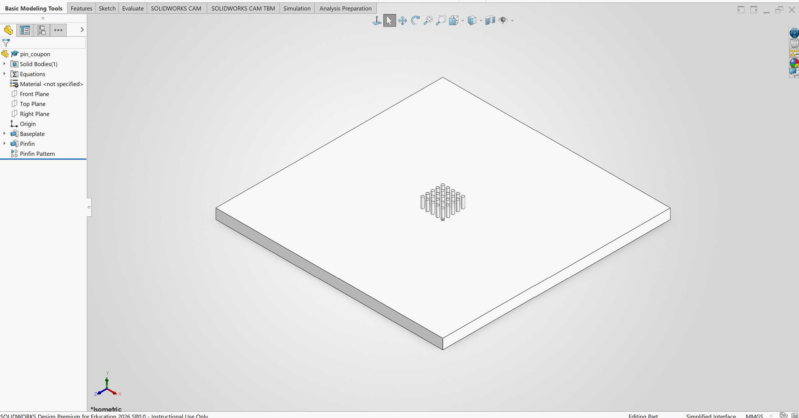

# Vendor answers: AlSi10Mg pin test coupon

**Why this exists:** before ordering Hoang et al.'s full reference plate, find out whether a commercial metal printer can make 0.5 mm pins in AlSi10Mg, and at what price.

**Part:** [`coupon/pin_coupon.STEP`](coupon/pin_coupon.STEP), a 45 × 45 × 2 mm base with a 5 × 5 patch of pins, Ø0.50 mm × 2.00 mm tall, 1.00 mm pitch (0.50 mm gaps). Checked on Oct 24: one solid body, millimeters, 25 pins, array centered on the base. Same pin size and spacing as Hoang's 0.5 mm design.

## Summary (Oct 25, 2026)

| Vendor | Process | AlSi10Mg? | Part | Shipping | Total | Timing | Status |
|---|---|---|---|---|---|---|---|
| JLC3DP | SLM | **No**: 316L and Ti TC4 only | n/a | n/a | n/a | n/a | Ruled out for the reference plate |
| PCBWay | SLM | Yes | $24.89 (pre-quote) | $26.55 (DHL, 2–4 days) | **$51.44** | 3–4 business days to build; est. ship Oct 28, deliver Oct 31 | Engineer review pending |
| Xometry | DMLS | Yes ("Aluminum AlSiMg") | $106.48 (list $140.28) | Check whether included | $106.48+ | Arrives Mon Nov 16 | Automated check passed; human not yet asked |

Prices are instant quotes for one coupon. The full plate (625 pins) may be repriced on review.

## Notes by vendor

### JLC3DP (Oct 24)
- Metal printing (SLM) materials offered: 316L stainless steel and titanium TC4. No aluminum.
- Stated tolerance: ±0.3 mm (within 100 mm) or ±0.4%. 316L roughness Ra 3.2–12 µm.
- Upload page rules: wall thickness > 1.2 mm, thinnest part ≥ 0.8 mm. These may be general rules rather than metal-specific, but the pins are below them either way.
- Why it is out: 316L conducts about 16 W/m·K against roughly 140 for AlSi10Mg. A stainless copy would not behave like Hoang's plate, so it could not validate the rig.

### PCBWay (Oct 24)
- 3D Printing → SLM → Aluminum (AlSi10Mg), color Metallic.
- The price is a system pre-quote; the official quote comes after an engineer reviews the part.
- "Wall thickness risk taken" is ticked by default, meaning print as-is at the customer's risk. Untick it so their engineer emails about thin features instead.
- Their CNC service lists copper, so the copper test vehicle can be quoted here in Phase 2.
- Future Innovators student program (announced Sept 2026): 50% off 3D printing and CNC, up to $200 per approved project. Apply with the copper block and reference plate as one project by Nov 8.

### Xometry (Oct 25)
- Metal 3D Printing → Direct Metal Laser Sintering (DMLS) → Aluminum AlSiMg, Standard finish, Standard inspection.
- $106.48 after a 24% discount from $140.28; arrives Mon Nov 16. Quote Q74-5737-9932.
- Automated manufacturability check passed 4/4 (confined hollow, model fidelity, floating parts, large part). None of these check pin thickness, so this does not confirm the pins will survive.

## Questions for a human at each vendor

1. Will 0.5 mm pins, 2 mm tall, survive printing and powder removal in AlSi10Mg?
2. What is your smallest reliable pin diameter in AlSi10Mg?
3. What tolerance can you hold on 0.5 mm features?
4. What as-printed surface roughness should I expect?
5. Could you quote the full plate later (25 × 25 pins over 25.4 × 25.4 mm on the same base)?

| Vendor | Asked on | Answer | Answered on |
|---|---|---|---|
| PCBWay | | | |
| Xometry | | | |

## What this means so far

- Only PCBWay and Xometry can print AlSi10Mg. PCBWay is cheaper and faster.
- Nobody has confirmed the 0.5 mm pins yet. The main risk is tolerance: ±0.3 mm-class tolerance on a 0.5 mm pin is more than half its diameter.
- If neither vendor will commit to the pins, Plan B in order: (1) a spare plate from the Binghamton authors, (2) a higher-end vendor, (3) a coarser published reference plate.
